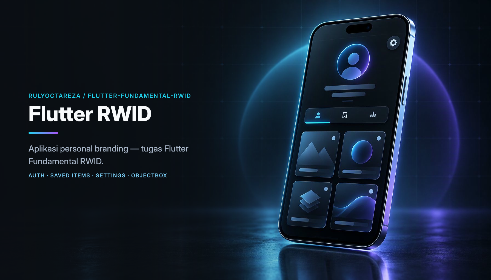
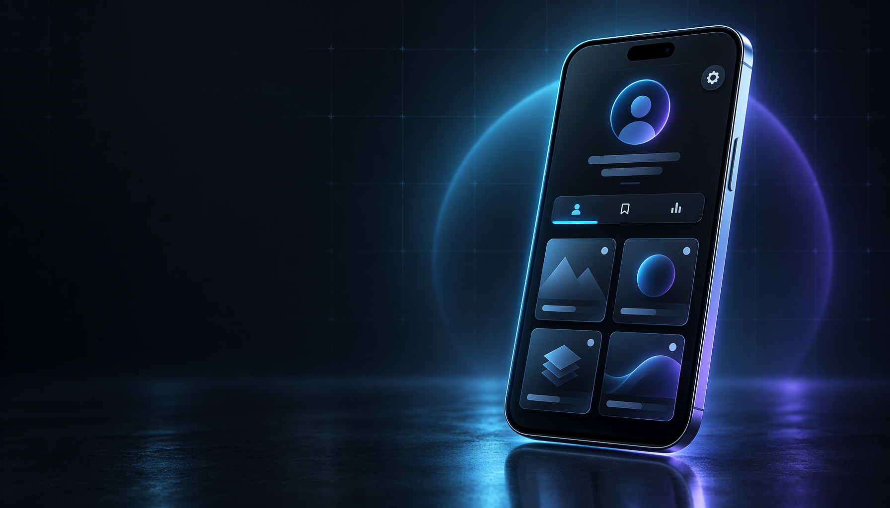

<p align="center">
  
</p>

<h1 align="center">Flutter RWID</h1>

<p align="center">
  <b>Aplikasi personal branding — tugas Flutter Fundamental RWID.</b><br>
  Auth · saved items · settings · ObjectBox
</p>

<p align="center">
  <a href="https://flutter.dev"></a>
  
</p>

---

## ✨ Preview

<p align="center">
  
</p>

<table align="center">
  <tr>
    <td></td>
    <td></td>
    <td></td>
  </tr>
  <tr>
    <td align="center">Homepage</td>
    <td align="center">Saved</td>
    <td align="center">Settings</td>
  </tr>
</table>

---

## 📖 Tentang

Aplikasi yang dibuat untuk memenuhi tugas **Flutter Fundamental RWID** sekaligus media
personal branding. Pengguna bisa login, menyimpan item, dan mengatur preferensi; data
disimpan lokal dengan ObjectBox.

---

## 🌟 Fitur

- 🔐 **Auth** — alur login
- 📌 **Saved** — item tersimpan
- ⚙️ **Settings** — preferensi aplikasi
- 💾 **Penyimpanan lokal** ObjectBox
- 🖼️ **Pemilihan gambar** dengan `image_picker`

---

## 🛠️ Tech Stack

| Area | Pilihan |
|---|---|
| Framework | Flutter |
| Database | ObjectBox |
| Media | `image_picker` |
| Penyimpanan | `path_provider` |

---

## 🚀 Menjalankan

```bash
flutter pub get

# generate model ObjectBox
dart run build_runner build --delete-conflicting-outputs

flutter run
```

---

## 🧪 Testing

```bash
flutter analyze
flutter test
```
